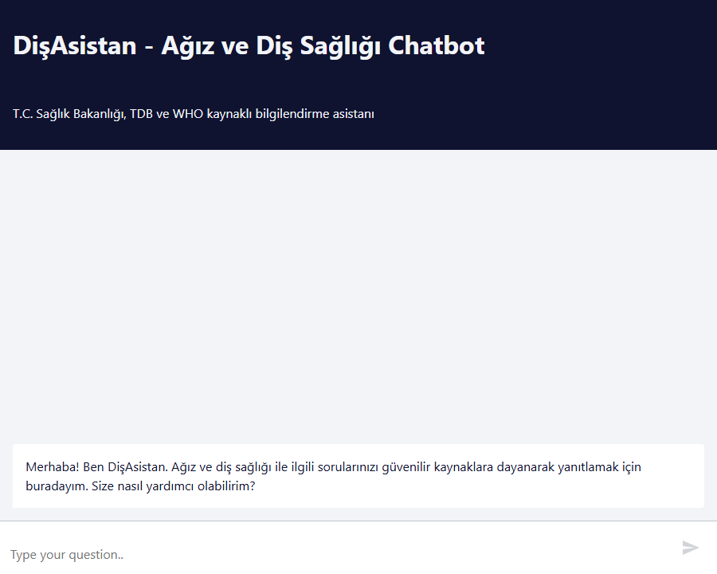
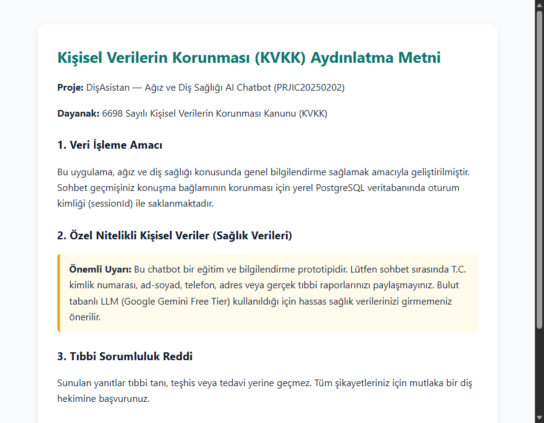
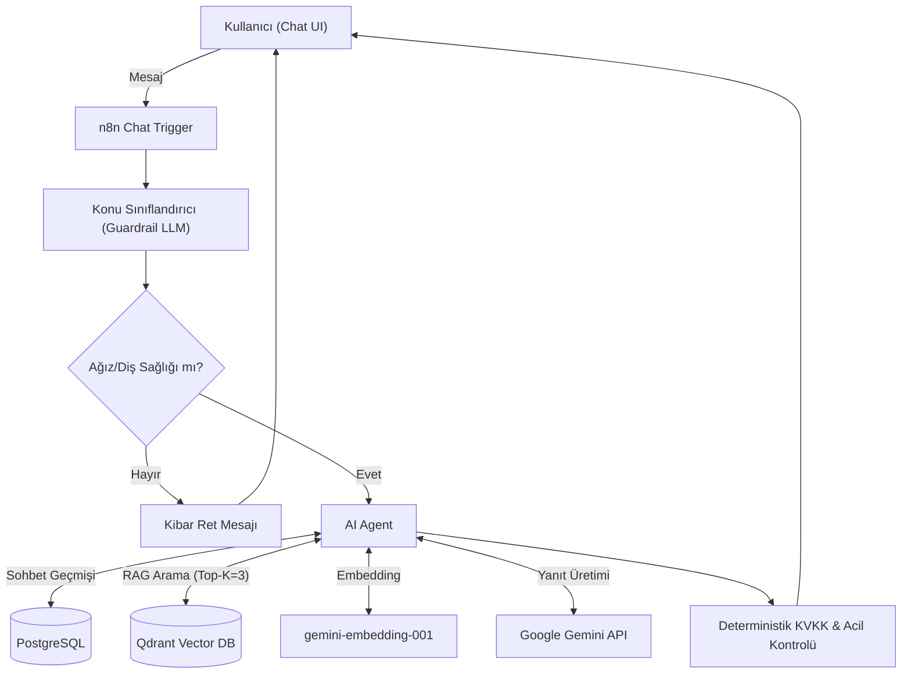

# 🦷 DişAsistan — Ağız ve Diş Sağlığı AI Chatbot

**Proje No:** `PRJIC20250202`  
**Teknolojiler:** `n8n` (Self-Hosted Docker) · `Google Gemini API` · `Qdrant Vector DB` · `PostgreSQL` · `Python`

**DişAsistan**, kullanıcıların ağız ve diş sağlığı ile ilgili sorularını **T.C. Sağlık Bakanlığı, Türk Dişhekimleri Birliği (TDB), Dünya Sağlık Örgütü (WHO) ve NIH/NIDCR** gibi güvenilir açık kaynaklara dayanarak **Türkçe** yanıtlayan, **RAG (Retrieval-Augmented Generation)** tabanlı bir yapay zeka asistanıdır.

---

## 📸 Ekran Görüntüleri

### Chat Arayüzü


### KVKK Aydınlatma Metni Sayfası *(Kişisel Sağlık Verisi Tespitinde)*


---

## ✨ Temel Özellikler

- **🔍 Güvenilir RAG Bilgi Tabanı:** 20 temel ağız ve diş sağlığı konusunda derlenmiş Türkçe bilgi tabanı `gemini-embedding-001` (3072 boyut) ile vektörleştirilerek **Qdrant** üzerinde saklanır.
- **🛡️ İkili Konu Sınıflandırıcı (Guardrail):** Gelen her mesaj AI Agent'a ulaşmadan önce kapsam kontrolünden geçer; ağız ve diş sağlığı dışındaki sorular (hava durumu, tarih, yemek tarifi, farklı tıp branşları vb.) AI Agent'a girmeden kibarca reddedilir.
- **📄 Hibrit KVKK Koruması:** Kullanıcı kişisel sağlık verisi veya şikayetini paylaştığında hem sistem promptu hem de deterministik `Code` node kontrolü ile yanıtın sonunda canlı **KVKK Aydınlatma Metni** bağlantısı (`/webhook/kvkk`) sunulur.
- **🩺 Tıbbi Sorumluluk ve Yönlendirme:** Sistem kesinlikle tanı koymaz, ilaç veya doz önermez; kullanıcıyı mutlaka bir **diş hekimine** (acil travma ve durmayan kanama durumlarında **112 Acil**'e) yönlendirir.
- **🧠 Konuşma Geçmişi (Memory):** Oturum bazlı (`sessionId`) sohbet geçmişi **PostgreSQL** (`n8n_chat_histories`) tablosunda kalıcı olarak tutulur.

---

## 🏗️ Sistem Mimarisi



---

## 📁 Proje Yapısı

```text
source_code/
├── docker-compose.yml                # n8n, PostgreSQL ve Qdrant servisleri
├── .env.example                      # Ortam değişkenleri şablonu
├── workflows/
│   ├── chatbot.json                  # Ana chatbot iş akışı (Guardrail + RAG + KVKK)
│   └── kvkk_sayfasi.json             # KVKK Aydınlatma Metni webhook sayfası
├── prompts/
│   └── system_prompt.md              # Türkçe AI Agent sistem promptu
├── data/processed/
│   └── agiz_dis_sagligi_kb.json      # 20 başlıklı açık kaynak Türkçe bilgi tabanı
├── scripts/
│   ├── ingest_qdrant.py              # Bilgi tabanını vektörleştirip Qdrant'a yükler
│   └── evaluate_chatbot.py           # 12 senaryoluk otomatik test scripti
├── tests/
│   └── test_sorulari.json            # Değerlendirme test senaryoları
└── docs/
    ├── veri_kaynaklari.md            # Açık veri kaynakları ve Qdrant şeması
    ├── kvkk_aydinlatma_metni.md      # KVKK metni
    └── images/                       # Ekran görüntüleri
```

---

## 🚀 Kurulum ve Çalıştırma

### 1. Gereksinimler
- **Docker Desktop** (çalışır durumda olmalıdır)
- **Python 3.10+** (`requests` paketi)
- **Google Gemini API Key** ([Google AI Studio](https://aistudio.google.com/apikey) üzerinden ücretsiz alınabilir)

### 2. Ortam Değişkenleri
`.env.example` dosyasını kopyalayarak `.env` dosyası oluşturun ve `GEMINI_API_KEY` değerini girin:
```bash
copy .env.example .env
```

### 3. Servisleri Başlatma
```bash
docker compose up -d
```

| Servis | Adres / Port | Açıklama |
|---|---|---|
| **n8n** | `http://localhost:5678` | Workflow motoru ve Chat arayüzü |
| **Qdrant** | `http://localhost:6333` | Vektör Veritabanı (RAG) |
| **PostgreSQL** | `localhost:5432` | n8n ve sohbet geçmişi veritabanı |

### 4. Bilgi Tabanını Qdrant'a Yükleme
```bash
pip install requests
python scripts/ingest_qdrant.py
```

### 5. n8n Workflow'larını Aktif Etme
1. `http://localhost:5678` adresinden n8n hesabınızı oluşturun.
2. **Credentials** bölümünden **Google Gemini API**, **Postgres** (`Host: postgres`, `Database: n8n`, `User: n8n`) ve **Qdrant API** (`URL: http://qdrant:6333`) bağlantılarını tanımlayın.
3. `workflows/kvkk_sayfasi.json` ve `workflows/chatbot.json` dosyalarını **Import from File...** ile içeri aktarıp yayınlayın (**Publish / Active**).

### 6. Otomatik Değerlendirme Testi
```bash
python scripts/evaluate_chatbot.py --url http://localhost:5678/webhook/<CHAT_WEBHOOK_ID>/chat
```

### 7. Servisleri Durdurma
```bash
docker compose down
```
*(Veriler Docker volume'larında kalıcı olarak saklanır.)*

---

## 📚 Detaylı Dokümantasyon

- [Veri Kaynakları ve RAG](docs/veri_kaynaklari.md)
- [KVKK Aydınlatma Metni](docs/kvkk_aydinlatma_metni.md)
