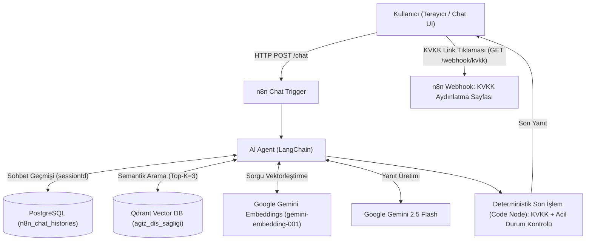

# Sistem Mimarisi — DişAsistan (PRJIC20250202)

Bu doküman, Ağız ve Diş Sağlığı AI Chatbot projesinin teknik mimarisini, veri akışını, kullanılan bileşenleri ve güvenlik/KVKK katmanlarını açıklar.

---

## 1. Genel Mimari Diyagramı

---

## 2. Sistem Bileşenleri ve Portlar

Tüm bileşenler yerel bilgisayarda **Docker Compose** (`docker-compose.yml`) üzerinde çalışır:

| Servis | Konteyner Adı | Port | Görevi |
|---|---|---|---|
| **n8n** | `chatbot-n8n` | `5678` | Self-hosted AI Agent Workflow motoru, Hosted Chat arayüzü ve KVKK Webhook sunucusu |
| **PostgreSQL 16** | `chatbot-postgres` | `5432` | n8n sistem veritabanı ve `n8n_chat_histories` tablosunda oturum bazlı konuşma geçmişi |
| **Qdrant** | `chatbot-qdrant` | `6333`, `6334` | RAG bilgi tabanı vektör veritabanı (`agiz_dis_sagligi` koleksiyonu, 3072 boyut, Cosine) |

---

## 3. İş Akışı (Workflow) Tasarımı

### 3.1 Ana Chatbot Akışı (`workflows/chatbot.json`)
1. **When chat message received (`chatTrigger`):** Kullanıcı mesajını ve `sessionId` bilgisini alır.
2. **AI Agent (`agent`):**
   - Türkçe sistem promptu (`prompts/system_prompt.md`) ile konu sınırlandırması, teşhis/ilaç yasağı ve prompt injection koruması uygular.
   - **Postgres Chat Memory:** Son 10 mesajlık konuşma geçmişini `n8n_chat_histories` tablosundan okur ve kaydeder.
   - **Qdrant Vector Store (`agiz_dis_sagligi_bilgi_tabani`):** Ağız ve diş sağlığı sorularında `gemini-embedding-001` ile semantik arama yaparak en ilgili 3 belge parçasını bağlama ekler.
3. **KVKK ve Güvenlik Kontrolü (`code`):**
   - LLM'e bırakılmadan **deterministik** olarak çalışır.
   - Kullanıcı mesajında kişisel sağlık verisi/şikayet anahtar kelimeleri tespit edilirse yanıtın altına `[KVKK Aydınlatma Metni](http://localhost:5678/webhook/kvkk)` bağlantısını ekler.
   - Acil durum belirtileri tespit edilirse **112 Acil / acil diş polikliniği** uyarısını ekler.

### 3.2 KVKK Aydınlatma Sayfası (`workflows/kvkk_sayfasi.json`)
- `GET http://localhost:5678/webhook/kvkk` adresinde canlı Türkçe KVKK Aydınlatma Metni HTML sayfası sunar.
